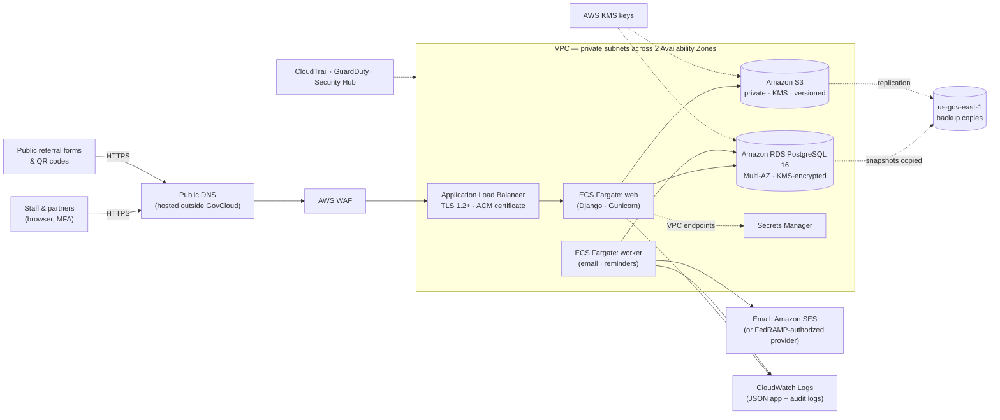

# Health Depot — AWS GovCloud (US) Deployment Plan

**Documentation only — nothing here has been deployed.** This is the planned production
architecture. The application was built so the same container image moves from local Docker
to AWS with only environment-variable changes (see CLAUDE.md §6). Commercial AWS regions work
the same way; GovCloud is preferred if CCHD or the State requires FedRAMP High / ITAR-grade
isolation.

> Verify service availability, quotas and pricing for the chosen GovCloud region at migration
> time — GovCloud offers a subset of AWS services and features, and they change.

## Target architecture (us-gov-west-1, with us-gov-east-1 for backups/DR)

## Local service → GovCloud equivalent

| Local (Docker) | AWS GovCloud | Environment variables that change |
|---|---|---|
| `proxy` (Caddy, HTTPS) | Application Load Balancer + ACM certificate + AWS WAF | `ALLOWED_HOSTS`, `CSRF_TRUSTED_ORIGINS`, `PUBLIC_BASE_URL` (e.g. `https://healthdepot.calvertcountymd.gov`) |
| `web` (Gunicorn) | ECS Fargate service, 2+ tasks across AZs | `GUNICORN_WORKERS` (size to task CPU) |
| `worker` | ECS Fargate service, 1 task (DB lock prevents duplicate jobs if scaled) | — |
| `migrate` | One-off ECS task run by the deploy pipeline | — |
| `db` (PostgreSQL 16) | Amazon RDS for PostgreSQL 16, Multi-AZ, KMS encryption, automated backups | `DATABASE_URL` (from Secrets Manager), drop `POSTGRES_*` |
| `s3` (SeaweedFS) | Amazon S3 bucket (private, versioned, SSE-KMS, Block Public Access) | `AWS_STORAGE_BUCKET_NAME`, `AWS_S3_REGION_NAME=us-gov-west-1`, **empty** `AWS_S3_ENDPOINT_URL` and `AWS_S3_PUBLIC_ENDPOINT_URL`, **remove** `AWS_ACCESS_KEY_ID`/`AWS_SECRET_ACCESS_KEY` (IAM task role), `S3_CREATE_BUCKET=false`, `AWS_USE_FIPS_ENDPOINT=true`, `CSP_STORAGE_ORIGIN` = the bucket's FIPS endpoint origin |
| `mailpit` | Amazon SES (SMTP interface) or another FedRAMP-authorized email service | `EMAIL_HOST`, `EMAIL_PORT=587`, `EMAIL_USE_TLS=true`, `EMAIL_HOST_USER`/`PASSWORD` (Secrets Manager), `DEFAULT_FROM_EMAIL` |
| `.env` file | ECS task definition env + Secrets Manager | `DJANGO_SECRET_KEY` (secret), `DEBUG=false`, `DEMO_MODE=false`, `DEMO_BANNER=false`, `SECURE_SSL_REDIRECT=true` |
| JSON logs on stdout | CloudWatch Logs (awslogs driver), retention per records policy | `LOG_FORMAT=json` |

No code changes are required for this mapping: storage uses the S3 API, email uses SMTP,
credentials come from the AWS default chain, and nothing references regions or ARNs.

## Infrastructure as code (Prompt G2)
AWS CDK in Python under `/infra`, partition-aware (`Aws.PARTITION`, never `arn:aws:`):
network (VPC, private subnets, VPC endpoints), data (RDS, S3, KMS), app (ECR, ECS services,
ALB, WAF), email, operations (CloudWatch alarms, budgets, CloudTrail). CI/CD with GitHub
Actions using OIDC federation for the `aws-us-gov` partition (no stored keys).

## GovCloud-specific items to verify at migration time
- **Account setup:** GovCloud accounts are requested through (and billed via) a commercial AWS
  account; account administrators must be U.S. persons and pass identity verification.
- **Service availability** in the chosen region for: ECS Fargate (and Graviton/arm64), RDS
  PostgreSQL 16, SES, WAF, ACM, Secrets Manager, GuardDuty, Security Hub, VPC endpoints.
- **DNS:** Route 53 public hosted zones are not offered in GovCloud — host public DNS in a
  commercial account or with the county's DNS provider; ACM certificates still live in GovCloud.
- **FIPS:** use FIPS endpoints for all AWS APIs (`AWS_USE_FIPS_ENDPOINT=true`) and a
  FIPS-validated base image for the container.
- **BAA:** accept the AWS Business Associate Addendum for the GovCloud account (AWS Artifact).
- **Cost:** GovCloud pricing is higher than commercial regions; budget accordingly.

## Rough monthly cost (estimate — confirm with the AWS Pricing Calculator)
For ~35 users and a few thousand referrals a year: ECS Fargate (2 web + 1 worker small tasks),
RDS Multi-AZ small instance, ALB, WAF, S3, CloudWatch, KMS, Secrets Manager — on the order of
**$400–$900/month in GovCloud** (lower in commercial AWS), excluding support plans and
staff time.

## Migration checklist (high level)
1. GovCloud account, IAM Identity Center with MFA, BAA accepted, budgets and alerts.
2. CDK bootstrap; deploy network, data and app stacks to a **staging** environment.
3. Configure SES (or provider), DNS and certificate; set Secrets Manager values.
4. Pipeline: build image → scan (Trivy) → push to ECR → run migrations task → deploy.
5. Security: WAF rules, GuardDuty, Security Hub standards, CloudTrail, log retention.
6. Data migration: import CCHD spreadsheets (built-in importer) and configure partners/forms.
7. Penetration test, load test (~35 concurrent users with headroom), restore drill.
8. Training, go-live, hypercare; production uses `DEMO_MODE=false`.

**Effort estimate:** about 3–5 weeks of engineering for infrastructure, pipeline, security
hardening and staging validation, in parallel with CCHD onboarding.
